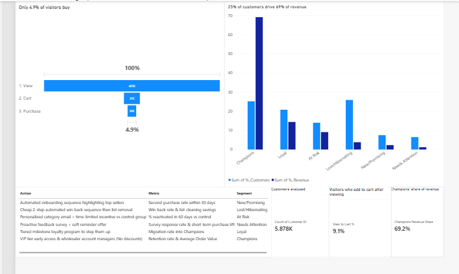

# E-Commerce Customer Funnel & RFM Segmentation

A two-part customer analysis: where shoppers drop off before buying, and which customers are worth protecting or winning back. Built with Python (pandas) and Power BI.



## Questions

1. At which step of the buying journey do most visitors leave?
2. Which customers drive revenue, and which have gone quiet?
3. What should a business do differently for each group?

## Data

| Part | Dataset | Size | Period |
|---|---|---|---|
| Funnel | [E-commerce events history in electronics store](https://www.kaggle.com/mkechinov/ecommerce-events-history-in-electronics-store) (Kaggle, REES46) | 885,129 events | Sep 2020 to Feb 2021 |
| RFM | [Online Retail II](https://archive.ics.uci.edu/dataset/502/online+retail+ii) (UCI) | 1,067,371 invoice lines | Dec 2009 to Dec 2011 |

I used two datasets because no single free dataset has both browsing events and invoice-level purchase history. They come from two different businesses (an electronics store and a UK gift-ware retailer), so the funnel results and the RFM results are not combined into one story.

## Method

### Funnel (electronics store)

- **Duplicates:** removed 655 exact duplicate rows (0.07%).
- **Missing brand and category:** about 24% of rows had no brand and 27% had no category. I labelled them "unknown" instead of dropping or guessing. I tried to recover categories through `product_id` and `category_id`, and neither recovered any, so "unknown" stays its own group.
- **Missing session:** dropped 162 rows with no `user_session`, since they cannot be placed in a visit (0.02% of rows).
- **Prices:** no zero or negative prices. Ten rows above 10,000 are all view events for TVs, monitors and printers with repeated identical prices, so I treated them as real catalogue prices and kept them. The currency is not stated in the data.
- **Funnel counted by unique users, not events.** Events over-count heavy users. By events, cart to purchase looks like 69%. By users it is about 54%.
- **Strict, time-ordered funnel:** a user counts at a stage only if they completed the earlier stages, in order. 132 users (0.7%) had a cart before their first view and were excluded.

### RFM (gift-ware retailer)

- **Removed** rows with no Customer ID (243,007, about 23%), cancelled invoices (invoice numbers starting with "C", 19,494 rows), and rows with quantity or price at or below zero. Removed duplicates.
- **Result:** 779,425 rows and 5,878 customers.
- **Snapshot date:** 2011-12-10, the day after the last transaction. Recency is measured from the data's own end date, not today's date.
- **Metrics per customer:** Recency (days since last order), Frequency (unique invoices, not rows, since one invoice has many rows), Monetary (total spend).
- **Scoring:** quintiles (1 to 5) on each metric. Recency labels are reversed because a smaller value is better. Frequency was ranked first to break ties, since many customers have exactly one order.
- **Segments** (rules applied in order):

| Segment | Rule |
|---|---|
| Champions | R >= 4 and F >= 4 |
| Loyal | R >= 3 and F >= 3 |
| New/Promising | R >= 4 and F <= 2 |
| At Risk | R <= 2 and F >= 3 |
| Lost/Hibernating | R <= 2 and F <= 2 |
| Needs Attention | Default group: matches none of the rules above |

## Key findings

**1. 91% of visitors leave between viewing a product and adding it to the cart (electronics store data).**
Only 9.1% of viewers add to cart. The data shows where visitors drop off, not why; product page content, price and photos are the first things to test.

**2. A small group of customers drives most of the revenue.**
The top 20% of customers generate 77.2% of revenue. Champions are 25% of customers but 69% of revenue.

**3. A few high-value accounts distort the average.**
Mean customer spend (£2,956) is 3.4x the median (£868), driven by likely wholesale accounts. The top spender averages about £4,000 per order, versus about £470 overall. For this reason I relied on the median and quintile scoring.

**4. A quarter of customers have gone quiet for over a year.**
1,523 customers (25.9%) are in Lost/Hibernating, averaging 459 days since their last order, and they bring 3.8% of revenue. Low-cost automated win-back fits better than paid campaigns.

**5. The At Risk segment is worth testing for reactivation.**
824 customers last bought about 369 days ago, but historically averaged 5 orders and £1,929 each, about £1.59M in past spend. Reactivating even a small share is worth a controlled test.

### Funnel (electronics store, unique users)

| Stage | Users | From previous stage |
|---|---|---|
| View | 406,817 | n/a |
| Add to cart | 36,946 | 9.1% |
| Purchase | 19,921 | 53.9% |
| **Overall** | | **4.9%** |

An extra check: 1,249 buyers (5.9%) have no cart event. This could come from a buy-now button, untracked cart events, or carts created before the data starts; I cannot tell which from this data.

### Category view (unique users)

| Category | Viewers | View to cart | Cart to purchase |
|---|---|---|---|
| computers | 115,515 | 14.8% | 55.2% |
| electronics | 89,729 | 7.8% | 59.3% |
| stationery | 23,208 | 10.0% | 67.3% |
| appliances | 22,373 | 4.2% | 59.2% |
| unknown | 129,885 | 6.3% | 58.7% |

- **Appliances** has the weakest view-to-cart rate among large categories. Product pages are the first place to look.
- **Computers** has the highest view-to-cart rate but the lowest cart-to-purchase rate among large categories, which points at checkout. With 17,073 carters, a 2 percentage point improvement is about 340 more buyers. Faster checkout, such as Apple Pay, is a hypothesis to A/B test, not a proven fix.
- Tiny categories such as apparel (83 viewers, 1 carter) are too small for their rates to mean anything.

### RFM segments

| Segment | Customers | % of customers | % of revenue | Avg days since last order | Avg orders | Avg spend |
|---|---|---|---|---|---|---|
| Champions | 1,482 | 25.2% | 69.2% | 20 | 16 | £8,114 |
| Loyal | 1,221 | 20.8% | 14.4% | 79 | 5 | £2,056 |
| At Risk | 824 | 14.0% | 9.1% | 369 | 5 | £1,929 |
| Lost/Hibernating | 1,523 | 25.9% | 3.8% | 459 | 1 | £430 |
| New/Promising | 443 | 7.5% | 2.3% | 28 | 1 | £885 |
| Needs Attention | 385 | 6.5% | 1.2% | 107 | 1 | £531 |

## Recommendations

| Segment | Action | Metric |
|---|---|---|
| Champions | VIP tier with early access, and account managers for wholesale accounts (no discounts) | Retention rate and average order value |
| Loyal | Tiered milestone loyalty programme to move them up | Migration rate into Champions |
| New/Promising | Automated onboarding sequence highlighting top sellers | Second-purchase rate within 30 days |
| At Risk | Personalised category email with a time-limited incentive, tested against a control group | % reactivated in 60 days vs control |
| Lost/Hibernating | Cheap two-step automated win-back sequence, then remove from the list | Win-back rate and list-cleaning savings |
| Needs Attention | Short feedback survey with a soft reminder offer | Survey response rate and short-term purchase lift |

## Limitations

1. **Missing Customer IDs.** About 23% of rows had no Customer ID and could not be scored, so the RFM analysis covers registered customers only and does not describe all sales.
2. **Old data.** The RFM data covers 2009 to 2011, so customer behaviour today may differ. The results demonstrate the method, not current business advice.
3. **Wholesalers and retail shoppers share one scale.** The top spender averages about £4,000 per order (580,987 / 145), versus about £470 for the average customer (mean spend 2,956 / mean frequency 6.3). Quintiles give a £2,500 customer the same top Monetary score as a £580K one, so the largest accounts are not separated. A better version would segment wholesalers separately.
4. **Returns were removed, not subtracted.** Customers who return a lot are slightly overvalued.
5. **Two different businesses.** The funnel and RFM results describe different companies and different years.
6. **The funnel shows where, not why.** About 27% of funnel rows have no category, and the data cannot explain why visitors leave, so the recommendations are hypotheses to test.

## Files

- `project.ipynb`: full analysis (cleaning, funnel, RFM)
- `ecommerce_rfm_dashboard.pbix`: Power BI dashboard
- `dashboard.png`: dashboard screenshot
- `rfm_segments.csv`: customer-level RFM scores and segments

## How to run

```
pip install pandas openpyxl kagglehub matplotlib
```

1. Download both datasets using the links above. The raw data is not included in this repository.
2. Update the file paths in the notebook.
3. Run `project.ipynb` from top to bottom.
4. Open the `.pbix` file in Power BI Desktop to view the dashboard.

## Author

Itodo Praise
[LinkedIn](https://www.linkedin.com/in/itodo-praise/) | [GitHub](https://github.com/praiseitodo57-cell)